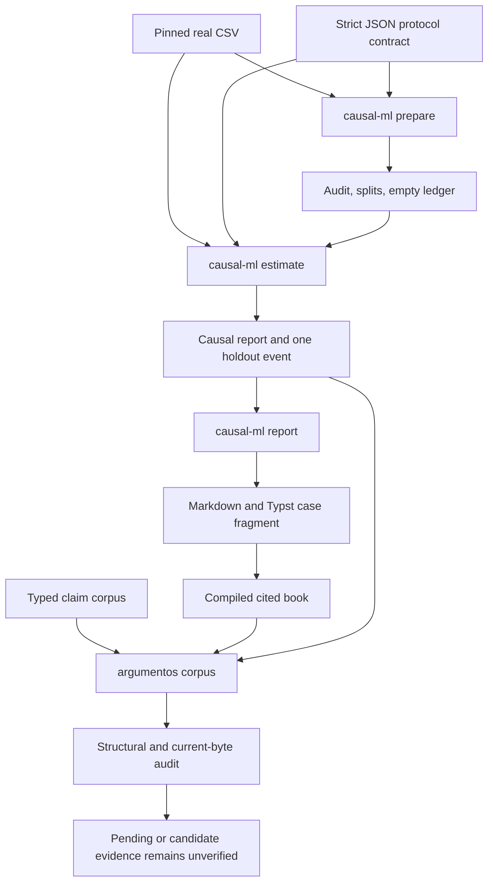

# Causal ML/AI: identification, implementation, and evidence

A Rust workspace for learning and auditing causal machine learning. It combines:

1. a citable, equation-based Typst book on causal identification and estimation;
2. a byte-pinned, genuinely observational LaLonde/NSW–PSID dataset and strict data contract;
3. deterministic CSV audits, entity/epoch split governance, and a holdout-use ledger;
4. an implemented cross-fitted AIPW case with explicit nuisance models and diagnostics;
5. the original typed argument kernel, now connected to the theory, data, protocol, and artifacts; and
6. a deterministic, read-only documentary ingestion workflow covering the production monograph, technical snapshot, and MCP operations collections in the parent repository.

> **Evidence boundary.** This project reproduces computations, not causal truth. The LaLonde comparison is observational, overlap is weak, the data-value license is unresolved upstream, and unmeasured confounding remains possible. `scientific_causal_claim_verified` and `corpus_closed` are deliberately `false`. Passing software checks is not scientific certification.

The typed-kernel, fixture, book, and bundled LaLonde workflows are local to this directory. The **documentary ingestion workflow additionally requires three declared sibling collections** in the parent repository, as detailed below; moving this directory without them makes its build and verification fail explicitly. No command reads a sealed sibling package or a previous external project state. All executable project tooling is Rust; the `python` evidence kind in the legacy argument schema is only a preserved enum value, not a Python dependency or runner. Imported source code is never executed.

## Quickstart

### Requirements

- Rust and Cargo (validated with 1.99.1; edition 2021); use the committed `Cargo.lock`.
- Typst 0.15.1 for the book.
- `curl`, `cmp`, and a SHA-256 utility only for optional independent upstream checks. Network access is not needed for the software checks; the pinned input must be restored locally for the real-data pipeline.

Run all commands from this directory (`argumentos copy/`). The Cargo package containing the `argumentos` binary is named **`arg-cli`**; the statistical package and binary are both **`causal-ml`**; and the documentary package is **`arg-ingest`**, with binary **`argumentos-corpus`**.

### Inspect the project without running estimation or creating a holdout event

```sh
mkdir -p build/book build/audits

cargo run --locked -p arg-cli -- doctor
cargo run --locked -p arg-cli -- fixtures --dir examples/fixtures
cargo run --locked -p arg-cli -- check --kernel corpus/causal_ml.json
cargo run --locked -p arg-cli -- corpus \
  --dir corpus --root . --json build/audits/corpus_audit.json

typst compile book/main.typ build/book/causal-ml-book.pdf --root .
```

`check` and `corpus` may return structural success while obligations remain pending. That is expected: they inventory and type-check the argument/evidence graph but do not replay evidence or verify prose anchors.

### Reproduce the real-data protocol in a new directory

Choose a new, empty output directory for each frozen protocol. These commands write only under ignored `build/` output:

```sh
cargo run --locked -p causal-ml -- prepare \
  --input data/real/lalonde.csv \
  --contract config/lalonde.contract.json \
  --output build/replay/lalonde

cargo run --locked -p causal-ml -- estimate \
  --input data/real/lalonde.csv \
  --contract config/lalonde.contract.json \
  --output build/replay/lalonde

cargo run --locked -p causal-ml -- report \
  --contract config/lalonde.contract.json \
  --output build/replay/lalonde \
  --markdown build/replay/lalonde/report.md \
  --typst build/replay/lalonde/lalonde.typ
```

- `prepare` streams CSV records through a structured parser, validates the contract, computes deterministic assignments, and writes `audit.json`, `splits.csv`, and an empty holdout ledger. Validated records are retained for statistics, duplicate detection, and modeling; end-to-end memory use is therefore not constant.
- `estimate` recomputes and verifies the audit/splits, fits only the declared estimator, and performs the feature/treatment-only calibration gate. It subsequently computes descriptive calibration outcome means for association reporting only—not model selection or revision—and, if the gate passes, records one final holdout evaluation before emitting `causal_report.json`.
- `report` reads saved artifacts without reopening raw outcomes or adding a ledger event. It generates both human-readable Markdown and the Typst case-study fragment.
- Repeating `estimate` in the same directory is refused. This is a local reproducibility guard, not a tamper-proof global registry. Never treat a fresh directory as permission to tune against holdout outcomes.

The checked-in `artifacts/lalonde/` is the **already-used final protocol record**. Do not run `prepare` or `estimate` into it. You can verify a clean replay byte-for-byte with:

```sh
cmp artifacts/lalonde/audit.json build/replay/lalonde/audit.json
cmp artifacts/lalonde/splits.csv build/replay/lalonde/splits.csv
cmp artifacts/lalonde/causal_report.json build/replay/lalonde/causal_report.json
cmp artifacts/lalonde/report.md build/replay/lalonde/report.md
cmp book/generated/lalonde.typ build/replay/lalonde/lalonde.typ
```

The holdout ledgers themselves need not be byte-identical because they contain a local access timestamp.

## Real LaLonde/NSW data: exactly what is included

The unmodified file `data/real/lalonde.csv` is the MatchIt `lalonde` sample copied by Rdatasets for local reproducibility. In this public repository snapshot it is intentionally not redistributed while the upstream data-value license remains unresolved; aggregate reports are committed. To use the frozen pipeline, obtain the pinned bytes independently and verify the SHA-256 below before running `prepare`:

- **Stable raw URL:** <https://raw.githubusercontent.com/vincentarelbundock/Rdatasets/1dcc2bf5f955cc1224a3e1307256e1fe86b68dae/csv/MatchIt/lalonde.csv>
- **Pinned source documentation:** <https://raw.githubusercontent.com/vincentarelbundock/Rdatasets/1dcc2bf5f955cc1224a3e1307256e1fe86b68dae/doc/MatchIt/lalonde.html>
- **Exact input:** 27,509 bytes; SHA-256 `a49703ca0233ba0a27fa9cda959a38a07f6825def0f7743cf2380ce4e57dd3ef`.
- **614 source rows:** 185 NSW treated observations and 429 nonexperimental PSID comparison observations.
- **Unit / treatment / outcome:** `rownames` source-row identifier, binary `treat`, and nominal-dollar 1978 earnings `re78`.
- **Declared baseline adjustment variables:** `age`, `educ`, `race`, `married`, `nodegree`, `re74`, and `re75`; the last two receive the frozen `log1p` transform.
- **Audit:** zero missing declared cells, exact duplicate records, or duplicate unit IDs; five repeated measurement vectors excluding ID remain warnings, not proof of repeated people.
- **Temporal limitation:** no epoch exists in this artifact, so entity-disjoint splitting is implemented but temporal separation is *unavailable*, not falsely inferred.

This is the NSW-treated plus PSID-comparison design associated with Dehejia and Wahba’s reanalysis following LaLonde. It is **not** the NSW randomized benchmark, Jobs data, IHDP, or a synthetic simulation. Synthetic data used by tests is generated separately under `target/test-work/` and cannot be confused with `data/real/`.

See `data/real/PROVENANCE.md` for retrieval time, upstream documentation, intellectual lineage, and direct-source links. Rdatasets explicitly says that it could not determine a definitive license for the actual data values. MatchIt's package GPL statement is not silently reassigned to those values. The bundled artifact is a reproducibility pin, **not a new license grant**; redistribution rights must be checked independently.

## What the executable estimator does—and does not do

The contract freezes a 60/20/20 train/calibration/holdout role assignment using a salted entity hash. Five-fold assignment inside train depends only on stable entity IDs, not on the salt or outcomes. The protocol also freezes declared transformations, fold-local standardization, and the following learners:

- logistic iteratively reweighted least squares for treatment propensity, with a fixed ridge penalty on non-intercept coefficients;
- separate ridge-linear outcome regressions for treated and control observations;
- primary propensity clipping at 0.05 and predeclared sensitivity calculations at 0.01 and 0.10; and
- normal-reference intervals based on the empirical AIPW influence function at the configured `confidence_level` (0.95 in the checked-in protocol). Reports carry a dynamic confidence level and interval label; legacy `normal_95_*` compatibility fields are emitted only at 0.95.

For each training fold, the implemented score on held-out fold observations is

\[
\widehat\psi_i = \widehat\mu_1(X_i)-\widehat\mu_0(X_i)
+ \frac{T_i\{Y_i-\widehat\mu_1(X_i)\}}{\widetilde e(X_i)}
- \frac{(1-T_i)\{Y_i-\widehat\mu_0(X_i)\}}{1-\widetilde e(X_i)},
\]

where nuisances are fitted without that observation's fold and \(\widetilde e\) is clipped propensity. Final holdout scoring uses nuisances fitted on train only. The report labels raw mean differences as **associational**, even when they are computed on the holdout. AIPW is an **adjusted contrast** whose causal interpretation is conditional on assumptions, not an automatic causal result.

The checked-in artifact reports an all-row unadjusted contrast of −635.0 nominal dollars, a train cross-fitted AIPW estimate of −269.3 (normal 95% interval [−2274.4, 1735.9]), and a final holdout AIPW estimate of 426.3 ([−3144.6, 3997.3]). Weak estimated support is explicit: 138/366 train and 41/134 holdout observations fall outside the primary [0.05, 0.95] raw-propensity interval. These numbers are transcribed from `artifacts/lalonde/report.md`; the authoritative full-precision values are in `causal_report.json`. They are not evidence of a beneficial or harmful population effect, and the intervals omit hidden-confounding, dataset-construction, model-selection, and transport uncertainty.

The calibration **gate** uses only features and treatment for computational, propensity-loss, and overlap diagnostics (`outcome_used_in_gate: false`; legacy `outcome_used` has the same gate-only meaning). Descriptive calibration `re78` outcome means are subsequently computed and reported (`outcomes_reported_descriptively: true`) as associations, never for model selection, recalibration, or threshold changes. A failed gate stops the run **before holdout outcomes are evaluated or reported**, although raw CSV parsing and all-record preparation summaries still occur and are not zero literal data access. A passing gate remains computational, not scientific approval or evidence of positivity; the report displays calibration weak-overlap counts beside it. Sensitivity clips are fixed calculations, not candidates for selecting a preferred estimate. The project does **not** estimate CATEs, train a treatment policy, construct hidden-confounding bounds, or deploy a decision service. Those subjects are covered theoretically and clearly marked as unimplemented in the executable case.

## Architecture and theory-to-practice map

### Data and evidence flow



### Chapter-to-implementation map

| Book chapter | Scientific content | Executable counterpart |
|---|---|---|
| 1. Claim taxonomy | Association, prediction, counterfactual, and operational claims | Claim kinds/scopes in `corpus/causal_ml.json`; association labels in reports |
| 2. Potential outcomes and SCMs | Neyman–Rubin outcomes, consistency, interference, DAG/SCM semantics, randomization | Estimand and required-assumption fields; no fabricated randomization |
| 3. Identification | Exchangeability, backdoor standardization, confounders, mediators, colliders | Explicit conditional identification boundary; baseline-only feature roles |
| 4. Positivity and diagnostics | Support, propensity tails, clipping, distinction between diagnostics and assumptions | Raw-propensity summaries, tail counts, separation/convergence diagnostics |
| 5. Estimation | IPW/AIPW derivations, cross-fitting/DML, CATE/meta-learners, policy learning | Implemented AIPW with named simple learners; advanced methods remain theory-only |
| 6. LaLonde case | Provenance, frozen protocol, empirical and identification limits | Bundled CSV, contract, audit, estimate, ledger, and generated Typst fragment |
| 7. Uncertainty and transport | Sampling versus identification uncertainty, sensitivity, external validity | IF intervals and fixed clipping sensitivities only; no hidden-confounding certification |
| 8. Governance and deployment | Feature availability, leakage, temporal/entity roles, monitoring, rollback | Strict data checks, split strategies, ledger; monitoring design without a fake live service |
| 9. Argument kernel | Typed claims, assumptions, canonical hashing, cycles, receipts and evidence limits | `arg-model`, `arg-check`, `arg-cli`, fixtures, and recursive corpus audit |

### Workspace components

- **`crates/arg-model`**: strict serde loading, duplicate-key and self-authored-status rejection, typed claims/expressions/evidence/receipts, and canonical content hashes.
- **`crates/arg-check`**: compiled `scientific_audit` and `structural` profiles, rule contracts, derivation-local cycle behavior, pending obligations, and candidate-only receipt admission. Its small SSCH fixture is exact arithmetic for one synthetic example, not a statistical law.
- **`crates/arg-cli`**: the `argumentos` executable (`doctor`, `check`, `fixtures`, `corpus`). The corpus command recursively detects cross-file ID collisions and missing local sources/artifacts, inventories current bytes and hashes, and never certifies scientific validity.
- **`crates/causal-ml`**: strict protocol contracts, typed CSV auditing, deterministic preprocessing and splits, source/audit/split/report hashing, leakage checks, logistic IRLS/ridge linear algebra, AIPW estimation, holdout bookkeeping, and Markdown/Typst rendering.
- **`crates/arg-ingest`**: deterministic source discovery, exact unit extraction, candidate indexing, provenance links, required-group coverage, duplicate/variant relations, verification, and read-only candidate queries.
- **`schemas/kernel.schema.json`**: exchange-shape documentation for argument kernel 1.0/1.1. The Rust loader, not an external schema runtime, enforces the contract.
- **`config/lalonde.contract.json`**: the real study protocol. `config/test.contract.json` is a generated-synthetic-test template, not public real-data provenance. `config/corpus-ingest.json` declares the documentary roots, parsing roles, exclusions, and required groups.
- **`book/`**: nine chapters, references, shared style, and an artifact-generated LaLonde fragment.
- **`artifacts/`**: inspectable generated reports, not a claim of evidence closure. `/build/` and `/target/` are ignored local outputs.

## Complete documentary corpus workflow

The `argumentos-corpus` workflow indexes the following parent-repository collections without modifying them or executing their code:

- `../02_causal AI en produccion/`;
- `../05_contenido_tecnico/`; and
- `../08_mcp-agentes-causales/`.

Three layers are intentionally separate:

| Layer | Current size | Evidentiary meaning |
|---|---:|---|
| Hardened typed kernel | 52 claims, 4 arguments, 30 evidence specifications, 49-atom registry | Structurally audited LaLonde/theory kernel; 59 checker counters remain pending |
| Exact documentary corpus | 388 discovered files, 370 included files, 10,130 source units | Complete relative to declared roots and policies, with exact hashes and byte/line spans |
| Extracted candidates | 2,252 unique candidates, 4,189 occurrences | Unreviewed normalized source assertions, **not** curated or scientifically verified arguments |

Every extracted candidate remains `source_assertion_unverified`, `unreviewed`, and `atomicity_status=not_assessed`. A content-derived `cand.<hash>` is not a durable curated identifier. `documentary_coverage_complete=true` is a structural statement about this declared ingestion policy, not semantic completeness, execution replay, identification, or scientific certification.

Build, verify, and query the ten deterministic artifacts with:

```sh
cargo run --locked -p arg-ingest -- build \
  --config config/corpus-ingest.json \
  --repository-root .. \
  --output artifacts/documentary-corpus

cargo run --locked -p arg-ingest -- verify \
  --config config/corpus-ingest.json \
  --repository-root .. \
  --output artifacts/documentary-corpus

cargo run --locked -p arg-ingest -- query \
  --candidates artifacts/documentary-corpus/argument_candidates.jsonl \
  --collection 08_mcp_operations \
  --topic contracts \
  --limit 5
```

All 15 required source groups pass. Coverage includes 290 parsed files, 80 metadata-only files, 18 explicit regular-file exclusions, 14 recorded pruned directories, 102 byte-identical monograph-file relations, and five content variants. Exclusions remain inventoried; no source occurrence is silently discarded by candidate deduplication.

See **`corpus/DOCUMENTARY_WORKFLOW.md`** for the complete operating procedure, collection-level counts, artifact guide, source limitations, and the required next semantic-curation stage. The generated summary is `artifacts/documentary-corpus/REPORT.md`. Documentary ingestion never reruns estimation or reopens the consumed LaLonde holdout.

## Argument and receipt semantics

The 1.1 atom-aware kernel now enforces more than the original:

- schema 1.0 defaults to `scientific_audit`; schema 1.1 defaults to `structural` unless a compiled profile is declared;
- claims have typed statements, expressions, assumption scopes, sources, and a closed atom registry when `atoms` is present;
- statuses such as `approved`, `lean_checked`, `reproduced`, and `claim_supported` cannot be self-authored into an input document or smuggled into a scope map;
- malformed/deep inputs, duplicate identifiers, unknown/unused atoms, symlink escapes, and inconsistent receipts fail closed;
- cycles are assessed per derivation and across argument-support SCCs; per-derivation adjudication preserves a distinct acyclic alternative;
- scope axes are fail-closed in both directions except declared aggregation keys (`role`, `clip`, `diagnostic`, `claim_class`, `limitation`) and the narrow finite/countable/infinite lattice;
- local source bytes and receipt targets/artifacts are resolved under a canonical project root; symlinks and escapes are rejected; and
- evidence availability remains `pending` or `candidate`; `registered` records current targets but is neither proof nor replay; and
- candidate receipts are internally checked against current local bytes where available, but this base never sets `claim_supported`, even if a receipt asserts execution and scientific criteria passed.

The corpus audit hashes local source files and registered artifacts as they exist now. It does **not** semantically verify JSON paths, Markdown headings, or Typst labels; it does not run Lean, execute external evidence, independently reproduce receipts, or turn structural validity into identification. `check --require-verified` merely returns exit code 3 while obligations remain; it cannot manufacture verification.

## Validation and release hygiene

Run the complete locked software checks:

```sh
cargo fmt --all -- --check
cargo check --workspace --all-targets --locked
cargo clippy --workspace --all-targets --locked -- -D warnings
cargo test --workspace --locked
cargo run --locked -p arg-cli -- fixtures --dir examples/fixtures
cargo run --locked -p arg-ingest -- verify \
  --config config/corpus-ingest.json \
  --repository-root .. \
  --output artifacts/documentary-corpus
cargo run --locked -p arg-cli -- corpus \
  --dir corpus --root . --json build/audits/corpus_audit.json
typst compile book/main.typ build/book/causal-ml-book.pdf --root .
```

The 107 deterministic tests include malformed/missing CSV fields, dtype/range and duplicate failures, source-hash mismatch, entity and epoch leakage, deterministic split behavior, numerical edge cases, artifact tampering, refusal of holdout reuse, bounded malicious JSON inputs, path/symlink escape rejection, receipt consistency/byte verification, atom-registry closure, aggregation/scope checks, cross-argument cycles, exact documentary-unit round trips, required-group matching, exclusion accounting, and deterministic verification/query behavior. Estimation regression tests use small synthetic fixtures only within test output; all published LaLonde numbers come from the real pinned artifact.

`/target/` and `/build/` are ignored. No generated PDF or clean-room replay is silently presented as a new checked-in scientific result. Any change to outcomes, features, learner, split salt/fractions, clipping, or scientific question after holdout access requires a transparently new protocol and analysis—not an in-place assertion that the old holdout remains untouched.

See `IMPLEMENTATION_REPORT.md` for executed commands, exact artifact digests, results, and unresolved limitations; `corpus/DOCUMENTARY_WORKFLOW.md` for documentary operation and curation boundaries; and `progress/STATE.json` for machine-readable project status rather than inherited external phase gates.

## Scientific and engineering limitations

1. NSW/PSID treatment assignment is not randomized; measured covariates do not establish conditional exchangeability.
2. Consistency, treatment versions, noninterference, sampling/target definitions, measurement validity, and transportability require substantive justification beyond this CSV.
3. Estimated overlap is weak. Clipping changes the estimator/weights and can hide support failure; it does not repair structural nonpositivity.
4. Main-effects logistic and linear outcome models can be misspecified; linear models can predict negative earnings. Double robustness is conditional, not universal protection.
5. Cross-fitting reduces particular overfitting biases but does not remove unmeasured confounding or data-construction bias.
6. Normal-reference IF intervals are approximate, are not cluster-robust here, and omit several important uncertainty sources.
7. Sensitivity to propensity clipping is not a sensitivity analysis for hidden confounding.
8. Source row IDs establish deterministic split keys, not verified longitudinal identities. No epoch or point-in-time production join is available.
9. The local ledger is neither externally witnessed nor immune to filesystem edits. Independent signed preregistration and replay would be needed for stronger governance.
10. Data-value redistribution rights remain unresolved upstream. The included checksum is provenance evidence, not legal permission.
11. Prose citation anchors and registered evidence have not been independently replayed or semantically verified by the structural checker.
12. CATE, meta-learners, policy learning, monitoring, rollback, and deployment are discussed at design level; they are not implemented claims about this case.
